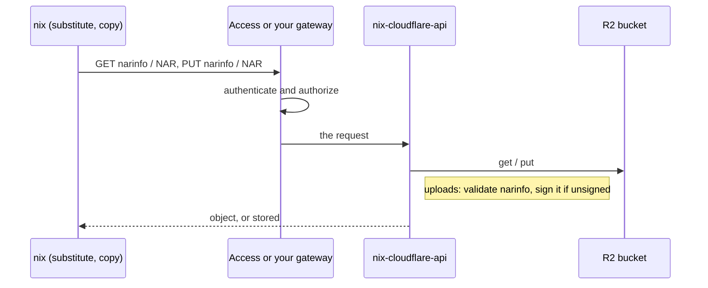

# nix-cloudflare

> A Nix binary cache on Cloudflare Workers and R2: substitutes come from
> Cloudflare's edge. It has no authentication or authorization of its own: it's
> open, and you protect it with Cloudflare Access or a gateway of your own.

[](https://github.com/nixos-contrib/nix-cloudflare/actions/workflows/ci.yml)
[](https://www.rust-lang.org/)
[](https://wiki.nixos.org/wiki/Flakes)
[](LICENSE)

> [!WARNING]
> **Pre-1.0.** The Worker's bindings and the module's inputs may still change
> between minor versions.

> [!WARNING]
> **The cache is open.** Anyone who can reach the Worker can read and upload, and
> the Worker signs what's uploaded with its key. Before you put it on the
> internet, protect it: see [Protecting the cache](#protecting-the-cache).

| | Ships as | What it is |
|---|---|---|
| [`crates/nix-cloudflare-api`](crates/nix-cloudflare-api) | `index.js` + `index_bg.wasm` in [Releases](https://github.com/nixos-contrib/nix-cloudflare/releases) | The server, a Cloudflare Worker written in Rust. Serves narinfo and NARs from R2, and validates and signs uploads. It has no authentication or authorization. |
| [`crates/nix-cloudflare-sdk`](crates/nix-cloudflare-sdk) | A Rust crate in this workspace; not published | The HTTP API's [OpenAPI document](crates/nix-cloudflare-sdk/openapi/nix/cache/v1/cachev1.yaml), and the types, server traits and client generated from it; hand-written beside them, the narinfo format and the health endpoints. The Worker builds on it. |
| [`deployment/terraform`](deployment/terraform) | `//deployment/terraform?ref=<version>` | Deploys the released Worker with its R2 bucket and bindings. |

The Worker and the module are released together from one tag.

## How it works



The Worker serves every request it gets. Who may read and who may upload is
decided in front of it, by Cloudflare Access or a gateway of your own, which is
the box in the middle: without one, there isn't a box, and the cache is open.

The only long-lived secret is the narinfo signing key, in Secrets Store.

## Do you need it?

Nix supports S3-compatible caches natively with the [`s3://`](https://nix.dev/manual/nix/2.23/store/types/s3-binary-cache-store) store, and R2 speaks the S3 API.

| Approach | Upload credentials | Signing key | Notes |
|---|---|---|---|
| `s3://` to R2 | An S3 key pair per uploader | On every uploader (`secret-key-files`) | Nix built-in; opaque blob storage |
| Public R2 bucket + `s3://` uploads | An S3 key pair per uploader | On every uploader | Anonymous reads via a custom domain |
| **nix-cloudflare** | **None: open, you add Access or a gateway** | **In the Worker (Secrets Store)** | Validates narinfo; one-request mass query |

If S3 keys on every uploader are acceptable to you, `s3://` to R2 is less to run.

Also: this is a hobby project. I wanted an excuse to spend more time with Cloudflare Workers and Rust, and a Nix cache made a good target.

## Quick start

1. **Create the signing key.** Generate it with `nix key generate-secret --key-name cache.example.com-1` and store it in Secrets Store. Clients need its public key (`nix key convert-secret-to-public`).
2. **Deploy the Worker** with the [Terraform module](deployment/terraform), on workers.dev (a custom domain is optional), then check that `<cache-url>/health/ready` returns `200`: the bindings were accepted and the signing key can be read.
3. **Point Nix at it** in `nix.conf`:
   ```ini
   substituters = https://nix-cloudflare-api.example.workers.dev https://cache.nixos.org
   trusted-public-keys = cache.example.com-1:<base64-public-key> cache.nixos.org-1:6NCHdD59X431o0gWypbMrAURkbJ16ZPMQFGspcDShjY=
   ```
4. **Upload** with `nix copy --to 'https://<cache>?compression=none' <paths>` (the cache stores uncompressed NARs). The Worker asks for no credentials: if you've put a gateway in front, send what it wants. Nix sends credentials only from a netrc file, as HTTP Basic.

## Protecting the cache

The Worker has no authentication or authorization. To decide who may read and
who may upload, put one of these in front of it:

- **Cloudflare Access**, as a self-hosted application on the cache's custom domain.
- **A gateway of your own**, a reverse proxy or Worker that authenticates callers and forwards to the cache.

Nix can't answer an Access login itself. To sign in from Nix, use
[nix-vault](https://github.com/nixos-contrib/nix-vault) (`aws-vault` for Nix): it
signs you in, keeps the credentials in your keychain, and runs Nix behind a local
proxy that adds the headers Access wants. This is nix-vault's documented setup
for Access; this project hasn't tested it end to end. See the
[Worker's README](crates/nix-cloudflare-api#access-control) for a profile and the limits.

## Development

Everything runs inside the dev shell (`nix develop`), which pins Rust, `worker-build`, `wrangler` and OpenTofu.

```sh
nix develop -c cargo test                                   # the Worker's and the SDK's tests
(cd deployment/terraform && nix develop -c sh -c "tofu init -backend=false && tofu test")   # the module's tests
```

Each directory's README has the rest: the [Worker's](crates/nix-cloudflare-api#development) covers the bundle, `wrangler dev` and the integration tests; the [SDK's](crates/nix-cloudflare-sdk#generated-code) how its code is generated; and the [module's](deployment/terraform#development) its tests.

Releases are cut by release-please from Conventional Commits. Each release is tagged `vX.Y.Z` and attaches `index.js` and `index_bg.wasm`. Pin the module to a release tag or its commit SHA: before 1.0 there is no floating major tag, because minor releases may break.

## License

[MIT](LICENSE)
